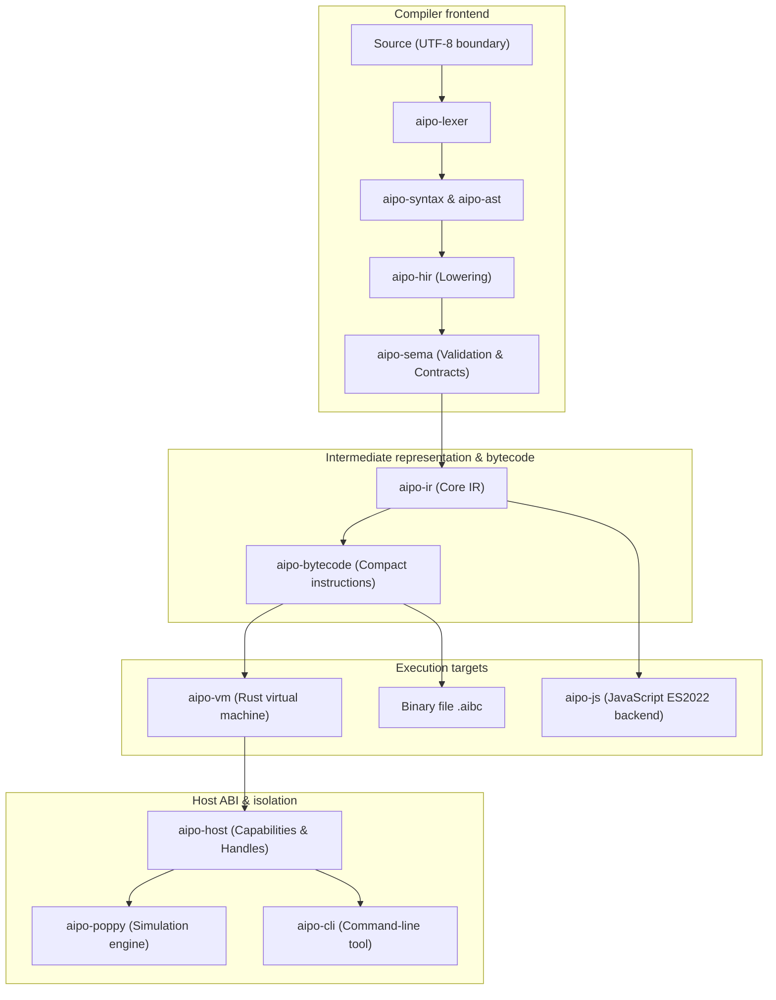

# System macro-architecture

Aipo's architecture follows **Clean Architecture** principles, high cohesion and low coupling,
with explicit domain boundaries between each layer of the compiler and the runtime.

---

## Layered architecture diagram

---

## Fundamental architectural invariants

1. **Frontend and backend agnosticism:** AST and HIR have no knowledge of how bytecode is
   emitted or of VM or JavaScript details.
2. **Result-based error model:** no Rust exception or panic may leak as an Aipo user error.
   All errors are mapped to stable diagnostic codes.
3. **Safe structural immutability:** mutations on structures are tracked and subject to
   invariant validation, ensuring internal state is never corrupted.
4. **No hidden allocation on the happy path:** critical dispatch and decode operations in the
   VM minimize value cloning and avoid unnecessary `Box`.

---

## Reference architectural documentation

- **[Bytecode & virtual machine](/architecture/bytecode-and-vm)**: specification of the
  stack-based VM and the `.aibc` binary format.
- **[Embedded & shell profile](/architecture/embedded-and-shell-profile)**: design of the
  reduced (Lua-style) profile, memory-footprint goals and Dual-Track architecture.
- **[Host ABI & sandboxing](/architecture/host-abi)**: capability-isolation model and host
  bindings.
