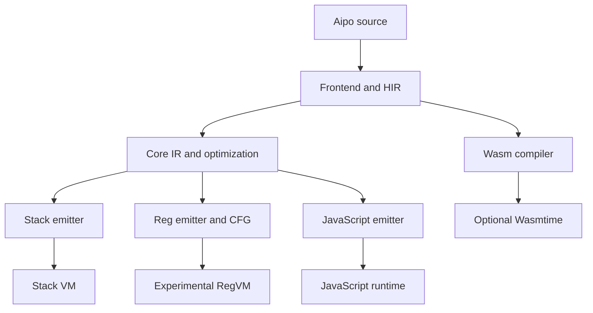
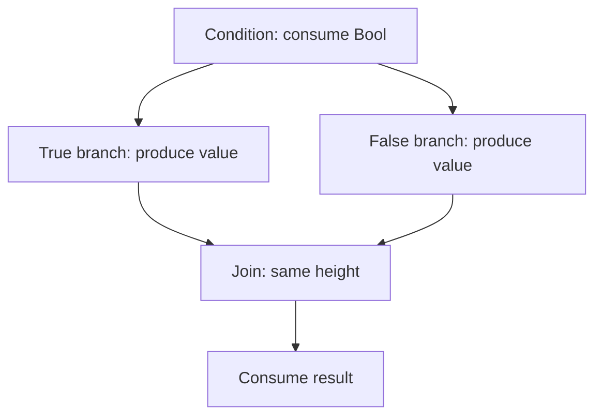

# Aipo runtime usage, audit and reimplementation guide

**Date:** 2026-10-09. **Base studied:** `488905ffb0b83ebbff458939542350d7280ad79b`.
**Integration base:** `bcbc4c991dee1d9f853c597aaed2790e8981b8b9`, incorporating the `wasm-encoder` update to `0.261.0` already present on `main`.
**Scope:** reconstruction of runtime fixes and reference studies after loss of the temporary copy of the revision.
**State:** implementation integrated into `main`; register backend experimental; Goal `P07-G01` in `DRAFT`.

> The original reconstruction did not run tests. The 2026-10-27 reconciliation ran the full workspace (1,130 tests), including Poppy, eGUI, game host and conformance VM/Reg. Results from the lost local version do not certify this version. Original evidence is in [P07-G01](../evidence/P07-G01-runtime-hardening.md) and current measurement in the [backend support matrix](../architecture/backend-support-matrix.md).

## 1. How to navigate

| Need | Where to start |
| --- | --- |
| Run programs and choose a backend | Sections 3 and 4 |
| Understand what changed and why | Sections 5 to 9 |
| Integrate the runtime in Rust | Section 10 |
| Reimplement these fixes | Section 11 |
| Measure performance without artificial conclusions | Section 12 |
| Continue studies and roadmap | Sections 13 and 14 |
| Review risks, compatibility and validation | Sections 15 and 16 |

Also read the [LLM study guide](../studies/llm-study-guide.md), the
[language authority map](../language/authority-map.md), the [CLI reference](../reference/cli.md)
and the [conformance corpus](../conformance/README.md). This guide explains implementation
changes; it does not replace the language specification.

## 2. Existing architecture

Aipo keeps a shared frontend. The stack, register and JavaScript backends receive Core IR. The
Wasm compiler receives HIR directly; it does not go through `RegEmitter`.



| Area | Main files | Responsibility |
| --- | --- | --- |
| Source and frontend | `aipo-source`, `aipo-lexer`, `aipo-syntax`, `aipo-ast`, `aipo-hir`, `aipo-sema` | Text, tokens, AST, HIR and semantic checks |
| IR | `crates/aipo-ir/src/ir.rs`, `builder.rs`, `opt.rs` | Neutral operations, lowering and optimizations |
| Register bytecode | `crates/aipo-bytecode/src/instruction.rs`, `reg_emitter.rs` | u32 encoding, limits and flow analysis |
| Execution and values | `crates/aipo-vm/src/reg_vm.rs`, `value.rs`, `convert.rs`, `vm/` | Runtime, errors, collections, conversions and contracts |
| CLI | `crates/aipo-cli/src/lib.rs` | Backend selection, stdlib registration, diagnostics and exit code |
| JavaScript | `crates/aipo-js/runtime/aipo-runtime.js` | Shim semantics and execution of emitted code |
| Wasm | `crates/aipo-wasm/src/compiler.rs`, `runner.rs` | Binary emission and optional Wasmtime integration |
| Host and ABI | `aipo-host`, `aipo-runtime`, `aipo-c-abi` | Capabilities, handles, native APIs and existing embedding |

No new crates or new language constructions were created. The organization follows the current
boundaries. The C ABI, ownership and reentrancy changes already in the base were not
reimplemented in this round.

## 3. Prepare and use the project

### 3.1 Checkout of the revision

After opening the PR, use the branch `audit/runtime-hardening-and-studies`:

```bash
git clone https://github.com/poppy-team/aipo-lang.git
cd aipo-lang
git fetch origin audit/runtime-hardening-and-studies
git switch --track origin/audit/runtime-hardening-and-studies
```

To obtain exactly one revision, prefer the commit SHA shown in the PR. A branch may receive new
commits; the SHA lets you reproduce the version read.

### 3.2 Build

The workspace declares `rust-version = "1.96"`, aligned with the Wasmtime 49.0.4 / Cranelift
0.136.4 graph of the lockfile. The reconciliation used Rust `1.99.1`; the per-profile MSRV
matrix remains a separate gate.

Default CLI build:

```bash
cargo build -p aipo-cli --locked
```

Build without the Wasmtime runner, preserving formatter, JS, regex and Unicode:

```bash
cargo build -p aipo-cli --locked --no-default-features --features formatter,js,regex,unicode
```

Wasm compiler available, without the JIT runner:

```bash
cargo build -p aipo-cli --locked --no-default-features --features formatter,js,regex,unicode,wasm
```

The `wasm` feature enables emission and inspection; `wasmtime-runner` enables execution.
Disabling the JIT reduces the graph, but does not turn the project into `no_std`. The `nano`
profile already exists in the workspace; size and startup need measurement on a defined target.

### 3.3 Usage commands

```bash
aipo check programa.aipo
aipo run programa.aipo --engine=vm
aipo run programa.aipo --engine=reg
aipo build programa.aipo --target js --out dist
aipo build programa.aipo --target wasm --out dist
aipo run programa.aipo --wasm
aipo run dist/app.wasm
aipo fmt programa.aipo --check
```

`--engine=reg` applies to execution on the experimental backend. `--target js` and
`--target wasm` choose other emitters. The examples assume the corresponding features are
enabled.

Exit codes remain: `0` for success, `1` for language/runtime failures and `2` for usage errors.
The absence of a feature may have a code defined by the existing CLI flow; consult the
diagnostic instead of inferring success from the absence of stdout alone.

## 4. Choosing a backend

| Backend | Use in this revision | Relevant limitation |
| --- | --- | --- |
| Stack VM | Reference for already-implemented semantics | Keeps its own budget and host mechanisms |
| RegVM | Scripts in the supported subset and embedding experiments | No complete parity; non-representable programs are rejected |
| JavaScript | JS emission with the project shim | Semantics depend on the matching runtime version |
| Wasm + Wasmtime | `.wasm` emission and execution when enabled | Optional fuel does not limit memory, output or callback work |
| Wasm without Wasmtime | Emission and disassembly | Execution returns a disabled-engine error |

The register backend is not promoted to a general substitute for the Stack VM. Closures,
upvalues, async/await, construction hooks, invariants, mutation journal and interface-contract
operations still require parity work. Core IR resources not supported generate
`AIPO_COMPILE_REG_UNSUPPORTED`; other runtime differences, such as full method resolution and
host services, remain pending.

## 5. Register emitter: corrections and limits

### 5.1 Compilation fails explicitly

**Before:** the final arm of the `match` was `_ => {}`. An instruction with no lowering was
silently dropped. An unknown binary operator became equality. `MakeFunction` used `expect`
when a function was not found.

**Now:** `compile_function` and `compile_module` return `Result<..., String>`. Unsupported
operations, missing function index, async/upvalue metadata and invalid limits produce a compile
error. The CLI converts the technical reason into a diagnostic with EN/PT-BR title and help
suggesting `--engine=vm`.

**Why:** producing bytecode with semantics different from the program is worse than reporting
the backend's limitation. Syntax accepted by the frontend does not imply that every backend
already implements every operation.

### 5.2 Stack height computed from flow

Core IR represents an evaluation stack, while bytecode uses registers. A `top` counter that
walks only textual order does not describe branches that converge.

Example:

```text
var flag = true
io.println(if flag then 10 else 20)
```

Both branches must produce a value in the same register, and the following call must consume
that value. The new `stack_heights` computes entry and exit effects of each instruction, walks
successors with a queue and requires equal heights at joins. Lowering restarts `top` with the
entry height of each reachable instruction.



`PushHandler` adds an edge to the handler with space for the failure value. `Return` and `Fail`
terminate the path. Unreachable instructions are not emitted, but preflight still rejects
unsupported IR categories and invalid destinations. This is not a complete type,
register-initialization or handler-balance analysis.

### 5.3 Encoding and operands

| Operand | Representable range | Policy |
| --- | --- | --- |
| Opcode | 7 bits | Only recognized variants |
| A and C as registers | `0..=255` | 256 physical slots |
| B | 9 bits | Role depends on opcode; when it is a register it must be < 256 |
| Bx | `0..=131071` | Up to 131,072 addressable entries |
| sBx | `-65536..=65535` | Offset relative to the next instruction |
| Name in `SetField`/`NewStruct` | `0..=511` | B is a constant index, not a register |
| Count in `NewList`/`NewDict`/`NewStruct` | `0..=255` | C limit; the number of registers may impose a smaller limit |

The emitter reserves temporaries after parameters and locals; it rejects functions without
enough space. A 256-element list cannot use an 8-bit C, even when the 256 values fit in
registers; preflight rejects the count instead of truncating it to zero. Jumps to the end of
Core IR point to a real implicit return. Out-of-range offsets are rejected before final
conversion.

Public encoders remain bit-masking utilities. Anyone using them directly must validate
operands before encoding; a truncated value cannot be recovered afterwards.

### 5.4 Opcodes added

| Code | Name | Contract |
| --- | --- | --- |
| 74 | `IterPrimary` | B holds the collection and C the full index |
| 75 | `IterKey` | Projection of key or position |
| 76 | `IterValue` | Projection of value |
| 77 | `IterGuard` | Records identity/value and observable length |
| 78 | `IterGuardEnd` | Removes the guard from the current activation |
| 79 | `AssertContract` | Type and position live in adjacent constants Bx/Bx+1 |
| 80 | `AssertContractNullable` | Same contract, accepting `none` |

The legacy `IterAt` opcode remains decodable: the two low bits of C hold the mode and the
rest the index register. That format supports only 64 index registers. The emitter now uses
the new opcodes to preserve all 8 bits of C.

## 6. RegVM: execution and state restoration

### 6.1 One arithmetic implementation

Arithmetic and equality opcodes delegate to `Value::add`, `sub`, `mul`, `div`, `int_div`,
`modulo`, `negate`, `not`, `equal` and `not_equal`, as the runtime's shared semantics.

This eliminates incomplete copies that handled only `Int` or `Float` pairs, classified
invalid operands as division by zero, did not check non-finite results or ignored numeric
promotion. Concatenation, structural equality and Unicode normalization follow the existing
helpers and their features.

The `Int` limit remains `±(2^53 - 1)`. Metadata/values built directly by a Rust host must
still respect the public invariants; this change does not create a full verifier for arbitrary
input.

### 6.2 Malformed bytecode

Execution checks register B according to the opcode's role, constant indices, global names,
argument slices and jump/handler destinations. A missing global raises `UndefinedGlobal`;
it is not replaced by `none`. A missing key in strict `Dict` lookup raises `KeyNotFound`.

Calls with slices beyond the 256-register array return `CorruptedBytecode`. Writing to
`Bytes` requires an `Int` index and a `Byte` value, checking everything before altering the
buffer. Range lengths use checked subtraction and the safe-integer limit.

These checks reduce concrete panic/corruption classes without guaranteeing that any value
graph or hostile bytecode is safe to execute. A complete register-bytecode verifier is still
missing.

### 6.3 Calls and handlers

`invoke_function` checks metadata, arity and depth before preparing the activation. The
default depth stays 64. Natives and native methods have arity checked before the callback;
`usize::MAX` keeps the variadic convention.

Caller registers, constants and PC are restored after return or `VmFault`. Each `run`
isolates its handler stack. A recoverable failure without a handler terminates the function
immediately; the caller may receive it and propagate to its own handler. The CLI turns a
top-level `Failure` into `VmError::UncaughtFailure`, with exit `1`.

There are no register windows yet: the call still swaps/saves a full array of 256 values.
The public arena remains reserved, with no integration into the storage of current `Rc`
values.

### 6.4 Instruction budget

`set_instruction_budget(Some(n))` enables the limit and resets the counter. Each bytecode
instruction consumes one unit before execution. Nested calls share the budget; new calls in the
same runtime keep consuming until an explicit reset. `Some(0)` rejects the first instruction.
`None` disables counting.

Exhaustion returns `VmFault::Overflow` with a budget message, preserving the existing runtime
catalog. No new budget code or CLI flag was invented. The limit does not cover time spent by
native callbacks, allocation, total memory or output.

## 7. Iteration, mutations and contracts

### 7.1 Dict follows canon

| Internal mode | `Dict` | List/String/Bytes/Range in the Reg subset |
| --- | --- | --- |
| Primary, `0` | Key in insertion order | Element |
| Key, `1` | Key in insertion order | Ordinal index |
| Value, `2` | Corresponding value | Element |

Previously, primary mode returned the `Dict` value in the Stack VM, the JS shim and RegVM.
The correction adjusts all three paths to the already-documented rule: `each key in dict`
returns keys. It does not change insertion order or invent new syntax.

```text
var d = {"a": 1, "b": 2}
each key in d {
    io.println(key)
}
each key, value in d {
    io.println(key + String(value))
}
```

Expected output: `a`, `b`, `a1`, `b2`, one per line. Fixture `33_dict_primary_iteration`
records this contract. The JS differential test expectation was corrected from the
specification, not by automatic snapshot regeneration.

### 7.2 Iteration guards

RegVM keeps guards per activation and preserves the caller's during calls. `IterGuardEnd`
cannot remove a caller guard. Return and error remove only the guards of the ending
activation.

Inserting a new key into a directly guarded `Dict` is rejected before writing; replacing the
value of an existing key remains allowed. Length comparisons before instructions and at the
end of execution detect size changes made by callbacks.

**Important limit:** guarding length is not versioning structural mutations. A callback may
remove and insert while keeping the same size; changes already made by a callback have no
automatic rollback. Introducing structural versions in `List`/`Dict` and making all mutators
consult guards is a pending improvement.

### 7.3 Supported contracts

The new opcodes keep the value in the register and verify fundamental types, `Function`,
struct names and enum-variant parents. `T?` accepts `none`. `Failure` stays on the
recoverable-failure channel, without being converted into a contract violation.

Type and textual position live in two consecutive constants. Emission of these pairs does not
use common deduplication, because Bx+1 must remain the diagnostic position.

Interface contracts with operations are rejected by the emitter until compatible method
resolution exists. Unresolved empty interfaces keep the Stack VM's permissive behavior. The
diagnostic shows a struct's nominal name when available.

## 8. Strings: fewer intermediate allocations

`string_char_at` centralizes reading a Unicode scalar. Stack `GetIndex`, positional read in
the Stack VM and RegVM share the helper.

For ASCII, an `is_ascii()` check allows byte access. For Unicode, positive indices use
`chars().nth` and negative ones `chars().nth_back`. `unsigned_abs` avoids negating `i64::MIN`.
Invalid indices return `IndexOutOfRange` with the length in scalars.

The change eliminates the temporary `Vec<char>` when reading one character. The result still
allocates a `String` and an `Rc`; it is not zero allocation. `is_ascii()` also traverses the
text: the ASCII path must not be advertised as totally O(1). For Unicode characters in the
middle, traversal remains linear. Slicing and other operations may keep their current
strategies.

There is no new benchmark result in this reconstruction. The
[protocol in section 12](#12-performance-reproducible-protocol) describes how to measure before
promoting the optimization to a quantitative claim.

No new benchmark result exists in this reconstruction. The protocol in section 12 describes
how to measure before promoting the optimization to a quantitative claim.

## 9. Wasm runner and dead-code removal

`WasmExecutionOptions { fuel: Option<u64> }` adds an optional budget. `execute_wasm` remains
available and delegates to the default options, keeping execution without limit.
`execute_wasm_with_options` configures `Config::consume_fuel` and `Store::set_fuel` before
instantiating the module, also covering a possible `start` function.

Entrypoints are searched in `__top_level__`, `run`, `main`, with signature `() -> i64` or
`() -> ()`. If none exists with a compatible signature, the runner returns `MissingExport`;
previously it returned success `0`.

`write_all` and `flush` now propagate errors. Accumulated output is delivered even after a
trap in the `start` function or the entrypoint, when possible. If execution and delivery both
fail, the original execution error takes priority. String reads from memory use checked
conversions and sums; invalid pointers/invalid UTF-8 are still ignored by this binding, with
no new trap contract.

The runner still accumulates all output in memory and creates engine/module per call. Fuel does
not resolve those costs. The implementation without the `wasmtime` feature keeps the explicit
disabled-JIT error.

Three never-read private indices were removed from `AsyncHelpers` and the private
`program_stmt_span` helper. The Wasm-exported async drive/sleep/cancel helpers are still
emitted. The removal is of dead metadata, not async functionality. Suites requiring JIT now
respect the feature; pure emission tests remain available without JIT. The formatter
equivalence suite is also feature-gated to allow compiling the CLI test targets without
optional dependencies.

## 10. Rust integration

### 10.1 Compile with RegEmitter

```rust
use aipo_bytecode::RegEmitter;

// `ir` is a CoreModule produced by the shared frontend.
let module = RegEmitter::new().compile_module(&ir)
    .map_err(|reason| format!("reg backend does not support the program: {reason}"))?;
```

The example is a fragment inside a function returning `Result`. Anyone using a direct return
must handle `Result` before accessing `top_level`, `functions` or passing the module to the
runtime.

### 10.2 RegVM budget and execution

```rust
use aipo_vm::RegVm;

let mut vm = RegVm::new();
vm.set_instruction_budget(Some(100_000));
let value = vm.run_module(&module)?;
let consumed = vm.instruction_count();
vm.reset_instruction_count();
```

`RegVm::new()`/`Default` are the recommended construction points. The new private fields
prevent external struct literals; this is a change to the experimental API. Install the needed
globals and callbacks: creating `RegVm` alone does not register the stdlib. The CLI bridges
this with the Stack VM's existing environment, but that global copy does not turn host services
into APIs supported by RegVM.

For `Value::Native`, declare exact arity or `usize::MAX` for variadics. The callback returns
`Result<Value, VmFault>`; blocking work and external operations need limits in the host
itself.

### 10.3 Wasm execution with fuel

```rust
use aipo_wasm::{WasmExecutionOptions, execute_wasm_with_options};

let options = WasmExecutionOptions { fuel: Some(1_000_000) };
let mut output = Vec::new();
let return_value = execute_wasm_with_options(&wasm_bytes, &mut output, options)?;
```

The function exists even without the JIT, but in that build it returns a disabled-engine error.
Configure memory and output limits separately if the program comes from an uncontrolled source.
The host must preserve the original failure message and decide how to present it in its
interface.

## 11. Reimplementation guide

1. **Fix the base and the contract.** Read `ENTRYPOINT`, Goal, authority map and the canon
   excerpts on numbers, failures and iteration. Separate specified behavior from optimizations
   still proposed.
2. **Enumerate operand roles.** For each opcode, mark A/B/C as register, count, constant or
   offset. B's check cannot be global, because its encoding has 9 bits and several roles.
3. **Preflight the IR.** Define `(consumes, produces)`, validate destinations and reject
   unsupported operations. Include unreachable instructions in the support classification.
4. **Compute the CFG.** Initialize height zero at the start; propagate through jumps and
   fallthrough; add the failure value on the handler edge; reject underflow, overflow and
   incompatible joins.
5. **Emit from entry height.** Do not use the previous branch's textual output to choose
   registers. Map IR indices to bytecode and add a real return before resolving destinations
   at the end.
6. **Centralize value operations.** Reuse helpers for numeric promotion, safe limit,
   finiteness, concatenation and equality. Avoid keeping a second semantics in Reg opcodes.
7. **Isolate activations.** Verify metadata before the call, save/restore registers/constants/
   PC and keep handlers local. Propagate `Failure` on return, without running remaining code
   in the failed function.
8. **Implement guards and contracts.** Preserve caller guards, do not allow underflow and use
   constant pairs for diagnostics. Reject interfaces that cannot yet be evaluated.
9. **Protect Wasm boundaries.** Install fuel before instantiating; validate entrypoint; check
   memory ranges and writer errors; preserve the execution failure if there is an additional
   output error.
10. **Synchronize surfaces.** Stable diagnostic code, EN/PT-BR titles, help, fixtures,
    changelog, crate contracts, study guide and evidence must describe the same revision.
11. **Validate in a future round.** Run the gates defined by the project before promoting the
    PR. In this delivery, test execution was explicitly waived by the user; that does not remove
    the validation requirement for a future certification.

When extending an opcode, update enum, `from_u8`, preflight, CFG, emitter, handler,
documentation and fixture. A handler without lowering leaves source without access; lowering
without a handler leaves bytecode without execution.

## 12. Performance: reproducible protocol

This round's goal is to remove unnecessary intermediate allocation and duplicated semantics.
There is no new quantitative certification.

To measure strings, use [index_bench.rs](../../crates/aipo-vm/examples/index_bench.rs) and
[index_paired.py](../../scripts/perf/index_paired.py). Compile the same harness on base and
candidate in release; archive code hash, binaries, toolchain, target, flags, CPU and repository
SHA.

The harness uses 4,096-character ASCII, 4,096 Unicode scalars and start/middle/end positions.
It warms up before measurement and emits a checksum to avoid optimizing away the work.

The driver alternates AB/BA, runs at least two batches and four pairs per batch, verifies
checksums and preserves individual samples. Variations up to ±5% are noise per the study
protocol. Do not mix binaries built with different flags or cold-start results with the
indexing loop.

```bash
cargo build -p aipo-vm --release --example index_bench --locked
python3 scripts/perf/index_paired.py --baseline /path/to/base/index_bench --candidate target/release/examples/index_bench --out index-results.json
```

The commands are reproduction instructions; they were not executed in this reconstruction. The
`layout_probe` probe is also available to measure `Value`, instruction, frame and register file
on the chosen target.

Register windows, shapes/slots, interning, method cache, lazy stdlib and specialized dispatch
need their own benchmarks. Results from other languages do not predict Aipo's gain.

## 13. Reference studies

The manifest [studies/refs.json](../../studies/refs.json) contains nine full SHAs. The default
search clones into `~/aipo-refs`; `AIPO_REFS_DIR` or `--dest` changes the destination, always
outside the Aipo repository.

```bash
./studies/fetch-refs.sh
./studies/fetch-refs.sh --verify
./studies/fetch-refs.sh --dest /path/to/aipo-refs --verify
```

`--verify` is offline: it compares manifest, lock, HEAD, origin and clean tree. Fetch refuses
dirty clones or divergent origins and publishes the lock only after completing everything. The
branch in the manifest is human context; reproduction uses the SHA, not that branch's HEAD.

Readings and actions are in [reference-vms](../studies/reference-vms.md),
[reference-runtimes](../studies/reference-runtimes.md) and
[lessons-for-aipo](../studies/lessons-for-aipo.md). Reading is directed at the cited regions;
it does not certify a full audit of all upstreams. No reference runtime was compiled,
integrated or measured in this reconstruction.

Important corrections to the old guide: the wasmi core is `no_std`; its WASI adapter is
separate and depends on `std`. WAMR is not the only candidate nor a measured winner. License
must be checked per file and revision. ADRs cited but absent were not invented to fill
documentation gaps.

## 14. What can still improve

| Priority | Improvement | Why | Future path and acceptance |
| --- | --- | --- | --- |
| P0 | Validate this reconstruction | Compiling does not prove behavior | Default/reduced gates, VM/Reg/JS conformance, Wasm fuel and output cases |
| P0 | Complete Reg verifier | Local checks do not prove flow/initialization | Operand roles, pool, functions, contracts, jumps, handlers and guards |
| P0 | Version structural mutations | Length does not detect all removals/insertions | Versions in collections, guards in all mutators and callback rules |
| P1 | Method, closure and upvalue parity | Many scripts still require the Stack VM | Cells and frames with defined ownership; differential corpus |
| P1 | Async/await and hooks in Reg | IR and runtime support incomplete | Preserve Model B, scheduler and invariant journal |
| P1 | Memory, output and host limits | Fuel does not limit those resources | Per-host policy and boundary tests; ADP-003 stays open |
| P1 | Register windows | Each call still swaps 256 values | Base/slots, correct unwind, two batches of call benchmarks |
| P1 | Field and constant indices | Linear searches/dedup grow with size | Shapes/slots/atoms with measurement and order preservation |
| P1 | MSRV per feature | The declared value is not certified by graph | Matrix with toolchains and supported dependencies |
| P2 | Real shell/nano profile | `no_std` and size goals do not arise from the profile alone | Audit deps/stdlib/host, build per target, measure size and startup |
| P2 | Wasm engine/module cache | Per-call creation may dominate startup | Explicit lifecycle and cold/warm comparison |
| P2 | Wasm output streaming | Current buffer may grow without limit | Writer/limit per execution and clear error contract |
| P2 | Diagnostic accessibility | Not every existing error has contextual help | EN/PT-BR catalog, useful suggestions and low-cognitive-load presentation |
| P2 | C/Rust certification per target | Boundaries and layouts vary by platform | Header/exports, ownership, reentrancy, ASan/UBSan/Miri where applicable |
| P3 | Compare alternative runtimes | Readings do not replace data | Same workload, checksum, flags, license and memory/time dimensions |

Not all of section 8's roadmap from the master guide was completed. The items above delimit the
next work without presenting studies as implemented features.

## 15. Compatibility and review notes

- **Experimental API:** `RegEmitter::compile_function`/`compile_module` now return `Result`;
  consumers must migrate.
- **RegVM construction:** new private fields require `new`/`Default` outside the crate.
- **Dict semantics:** programs that relied on the primary-iteration-by-values bug must use the
  `key, value` binding defined by canon.
- **Reg bytecode:** new opcodes require the matching runtime. The format still lacks an
  independent cross-version compatibility certification.
- **Wasm:** missing entrypoint and writer error now return failure, which may reveal errors
  previously reported as success.
- **Profiles:** test guards respect features, but the behavioral matrix still needs execution.
- **Governance:** `prumo.json` keeps its historical state; no phase/Goal transition was
  fabricated. Publishing as draft does not imply Prumo approval or completion of gates.

## 16. Evidence and next validation

The evidence records the base, files, static inspection, actually observed compilations and
unexecuted gates. The commands below are a roadmap for another round, not results of this
delivery:

```bash
cargo fmt --all -- --check
cargo clippy --workspace --all-targets -- -D warnings
cargo test --workspace
cargo doc --workspace --no-deps
prumo validate .
prumo doctor .
node crates/aipo-js/runtime/selftest.mjs
```

Include builds/tests without `wasm`, with `wasm` without `wasmtime-runner` and with the full
runner. For Wasm, cover missing entrypoint, zero/finite fuel, infinite loop, write error and
flush error. For Reg, cover arities, malformed operands, caller restoration, handlers, guards,
contracts, high index and conditional branches.

The delivery must be reviewed through the PR diff and the files of this commit. Temporary links
and numbers from the lost revision are not the source of truth of this publication.
